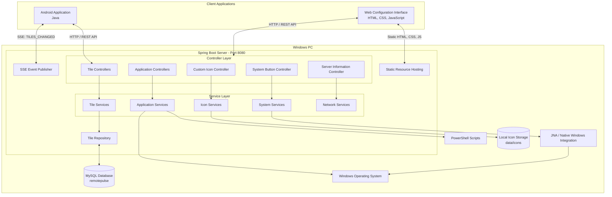

# Remote Pulse

**A Windows PC remote-control system with an Android client, a Spring Boot backend, and a browser-based configuration interface.**

Remote Pulse allows a user to control selected Windows PC applications and system functions from an Android device over a local network. The Windows PC runs a Java Spring Boot server, which exposes REST APIs for configuration and command execution. The Android application communicates with this server to retrieve the available controls and execute commands.

A separate browser-based configuration interface allows users to manage the controls displayed on the Android application, discover installed applications, configure websites and applications, and manage custom icons.

The project combines Java backend development, Android development, database persistence, Windows system integration, PowerShell automation, and real-time communication.


---

## 1. The Problem Remote Pulse Solves

Normally, interacting with applications on a Windows PC requires direct access to the computer through its keyboard, mouse, or desktop interface.

This becomes inconvenient when the user wants to perform simple operations remotely, such as:

- Opening a frequently used desktop application.
- Launching a website.
- Executing a configured Windows system operation.
- Triggering a keyboard shortcut.
- Accessing frequently used controls without navigating through the Windows desktop.

Remote Pulse addresses this by providing a configurable remote-control interface on an Android device.

Instead of implementing the Windows operations directly inside the Android application, the project uses a client–server architecture. The Android device sends requests to the Spring Boot server running on the Windows PC. The server processes the requests and interacts with the Windows environment.

The configuration interface and database allow the available controls to be modified without rebuilding the Android application whenever a tile needs to be changed.

## 2. System Architecture

Remote Pulse follows a client–server architecture consisting of three primary application components:

1. **Android Client:** Provides the remote-control interface and sends commands to the Windows PC.
2. **Spring Boot Server:** Runs on the Windows PC, processes incoming requests, manages tile configurations, and performs the required operations.
3. **Web Configuration Interface:** Allows the user to create, modify, and manage the controls available to the Android client.

MySQL provides persistent storage for tile configurations. The Windows operating system provides the environment in which configured applications and system operations are executed.

### 2.1 Architecture Diagram



*This is a logical representation of the application architecture. It illustrates the clients, backend layers, database, and Windows integration components. It does not imply that every module directly communicates with every component.*

### 2.2 Android Client

The Android application acts as the remote-control client.

When the application starts, the user provides the address of the Windows PC running the Remote Pulse server. The Android application uses that address to communicate with the backend.

The client retrieves the available tile configurations from the server and displays them in a grid interface.

When a user selects a tile, the Android application sends a launch request to the corresponding backend endpoint. The Android application does not directly execute Windows commands. The Windows-side server is responsible for processing them.

The Android application also maintains an SSE connection to receive notifications when tile configurations change.

### 2.3 Spring Boot Server

The Spring Boot application runs on the Windows PC on port `8080`.

It acts as the central processing layer between the Android client, browser-based configuration interface, database, and Windows operating system.

Its responsibilities include:

- Exposing REST endpoints.
- Retrieving and updating tile configurations.
- Persisting configuration data through Spring Data JPA and Hibernate.
- Processing application discovery and configuration requests.
- Managing custom icon operations.
- Executing supported Windows operations.
- Publishing tile-change notifications through SSE.
- Providing server network information.

The backend is organized into functional packages rather than placing all controllers, services, and entities in one package.

### 2.4 Web Configuration Interface

The browser-based configuration interface is served by the Spring Boot application.

It uses HTML, CSS, and JavaScript to communicate with the backend.

It allows users to manage tile configurations without modifying the Android application.

The interface communicates with backend endpoints to save application details, configure websites, discover installed applications, manage icons, and update existing tiles.

### 2.5 Database Layer

Remote Pulse uses MySQL with Spring Data JPA and Hibernate.

Tile configurations are stored persistently so that they remain available after the server restarts.

The `Tile` entity contains the following fields:

| Field | Purpose |
|---|---|
| `id` | Database identifier |
| `slotNumber` | Identifies the tile's position |
| `name` | Display name |
| `type` | Determines the type of operation |
| `target` | Stores the configured destination or target |
| `icon` | Stores the icon reference |

The database is named `remotepulse`.

### 2.6 Windows Integration

The Spring Boot server runs directly on Windows, allowing the backend to interact with the operating system.

Different mechanisms are used for different operations:

- Java `ProcessBuilder` is used to start external processes.
- Windows command execution is used for supported application and website launching.
- JNA provides Java access to native Windows functionality.
- PowerShell scripts automate Windows-specific tasks, including installed-application discovery and icon-related operations.

This separation allows the Android application to remain independent of Windows-specific implementation details.

## 3. Technologies and Tools Used

| Technology | How it is used |
|---|---|
| Java 23 | Backend application development |
| Spring Boot | Backend application framework and REST API development |
| Spring Data JPA | Database access and persistence |
| Hibernate | JPA implementation and ORM |
| MySQL | Persistent storage for tile configurations |
| JNA 5.18.1 | Java integration with native Windows functionality |
| PowerShell | Windows automation and application discovery scripts |
| Android (Java) | Remote-control client |
| HTML | Configuration interface structure |
| CSS | Configuration interface styling |
| JavaScript | Frontend interaction and backend API communication |
| Maven | Backend dependency management and build |
| Android Studio | Android application development |
| MySQL Workbench | Database inspection and management |
| Gson | JSON parsing in the Android application |
| Glide | Loading images and icons in Android |

## 4. Important Technical Concepts

### 4.1 Client–Server Architecture

Client–server architecture separates the application interface from the logic responsible for processing requests.

In Remote Pulse:

- The Android application is a client.
- The browser configuration interface is another client.
- The Spring Boot application is the server.
- MySQL stores persistent application data.

The clients communicate with the server over the local network.

For example, when a user selects a tile on Android, the client sends an HTTP request to the server. The server identifies the requested tile, processes the operation, and returns an HTTP response.

This design keeps Windows-specific functionality on the PC rather than attempting to implement it on Android.

### 4.2 REST APIs

REST APIs allow the Android application and browser interface to communicate with the Spring Boot backend using HTTP.

Remote Pulse uses HTTP methods according to the operation being performed.

Examples include:

- `GET` to retrieve tile configurations.
- `PUT` to update an existing tile.
- `POST` to execute a launch operation.
- `DELETE` to remove a tile configuration.

The Android application uses the server address supplied by the user to construct its API requests.

### 4.3 Server-Sent Events (SSE)

Server-Sent Events provide a mechanism for the server to send real-time notifications to a connected client over an HTTP connection.

Remote Pulse uses SSE to notify the Android application when tile configurations change.

Without SSE, the Android application would need to repeatedly request the tile list to check whether anything had changed. This approach is known as polling and creates unnecessary repeated requests when no changes have occurred.

With SSE, the Android application maintains a connection to:

```text
GET /api/tiles/events
```

When a tile configuration changes, the backend publishes the event:

```text
TILES_CHANGED
```

The Android application listens for this event and reloads its tile configurations.

**The important distinction:** SSE is used for server-to-client notifications. Normal REST requests are still used for operations such as retrieving tiles and launching them.

### 4.4 Java System Programming

Java applications can interact with the operating system by starting processes and using native system interfaces.

Remote Pulse uses Java system-level integration to perform operations on the Windows PC.

For example, `ProcessBuilder` allows Java to create and start external processes. This is useful when the backend needs to execute a Windows command or launch an external executable.

The project also uses JNA for access to native Windows functionality where required.

### 4.5 JNA and Windows API Integration

JNA (Java Native Access) allows Java applications to access native libraries and functions without requiring custom JNI native-code implementations for every interaction.

Windows exposes native functions through its system libraries and APIs.

JNA acts as a bridge between Java code and these native functions.

In Remote Pulse, JNA is included to support Windows-specific integration. The exact native functions and their responsibilities should be documented alongside the corresponding implementation classes.

### 4.6 PowerShell Automation

PowerShell is a command-line shell and scripting language designed for system administration and automation on Windows.

Remote Pulse uses PowerShell scripts for Windows-specific tasks that are more conveniently handled through PowerShell than through ordinary Java APIs.

The project includes scripts for installed-application discovery and icon-related operations.

The general integration pattern is:

1. Java initiates the required script or command.
2. PowerShell performs the Windows-specific operation.
3. The script produces the required output.
4. The backend processes that output and makes the result available to the configuration interface.

The exact script arguments and output format should be documented from the actual `.ps1` files.

### 4.7 Database Persistence

Remote Pulse uses MySQL to store tile configurations.

Spring Data JPA provides the repository abstraction, while Hibernate handles ORM operations.

The `Tile` entity represents the tile configuration in Java, and the repository provides database access.

This avoids manually writing SQL for every basic database operation and allows the application to retrieve and update configurations through the persistence layer.

## 5. Application Features

### 5.1 Android Remote-Control Interface

- Connects to the Windows PC using its server IP address.
- Retrieves the available tile configurations.
- Displays 18 configurable tiles in a 3-column, 6-row layout.
- Supports tile launching through backend API requests.
- Receives configuration-change notifications through SSE.
- Refreshes tile data when the server sends `TILES_CHANGED`.

### 5.2 Tile Configuration

Each tile contains a name, type, target, and icon reference.

The supported tile types are:

| Tile type | Purpose |
|---|---|
| `CUSTOM_APP` | Configured custom application |
| `WEBSITE` | Opens a configured website |
| `INSTALLED_APP` | Represents an installed application |
| `SYSTEM_BUTTON` | Represents a supported system operation |
| `KEYBOARD_SHORTCUT` | Represents a configured keyboard shortcut |

The configuration interface allows users to manage the tiles without changing the Android application code.

### 5.3 Installed Application Discovery

The application includes installed-application discovery functionality using Windows-specific automation.

This makes it possible to identify applications available on the PC and use them when configuring Remote Pulse tiles.

### 5.4 Custom Icon Management

The project supports custom icon operations through backend endpoints.

Icons are stored locally by the server and referenced by the application interface.

This allows tile configurations to use application-specific or custom icons instead of relying exclusively on default icons.

### 5.5 Real-Time Configuration Synchronization

When a tile configuration is changed through the web interface, the backend can notify connected Android clients using SSE.

The Android application then reloads its tile data.

This keeps the Android interface synchronized with the server's current configuration without requiring the user to restart the application.

## 6. Input and Output Flow

### 6.1 Connecting Android to the Server

**Input:** The user enters the Windows PC's server IP address.

**Processing:**

1. Android constructs the server URL.
2. It sends a `GET` request to `/api/tiles`.
3. The Spring Boot server receives the request.
4. The backend retrieves tile data.
5. The server returns the response.

**Output:** If the connection succeeds, the Android application opens the tile interface and loads the available tiles.

### 6.2 Fetching Tiles

```text
Android Application
        |
        | GET /api/tiles
        v
TileController
        |
        v
TileService
        |
        v
TileRepository
        |
        v
     MySQL
        |
        v
    Tile Data
        |
        v
Android Tile Interface
```

The backend retrieves the stored tile configurations and returns them to the Android application as JSON.

The Android application parses the JSON into `Tile` objects and displays the corresponding information.

### 6.3 Launching a Tile

**Input:** The user selects a tile on Android.

**Request:**

```http
POST /api/tiles/slot/{slotNumber}/launch
```

**Processing:**

1. Android sends the selected slot number to the server.
2. The backend identifies the corresponding tile.
3. The launch logic processes the tile type and target.
4. The server executes the supported operation on Windows.
5. The backend returns the result.

**Output:** The configured application, website, or supported operation is triggered on the Windows PC.

### 6.4 Updating Tile Configuration

**Input:** The user changes a tile using the browser-based configuration interface.

**Processing:**

1. JavaScript sends an HTTP request to the relevant backend endpoint.
2. The backend receives the updated configuration.
3. The tile update logic processes the request.
4. The updated data is persisted in MySQL.
5. The backend publishes an SSE notification.

**Output:** The configuration is saved, and connected Android clients receive a notification to reload their tile data.

### 6.5 SSE Notification and Android Refresh

```text
Web Configuration Interface
          |
          | Update Tile
          v
    Spring Boot Server
          |
          | Save Configuration
          v
         MySQL
          |
          | Publish SSE Event
          v
    Android Application
          |
          | Receive TILES_CHANGED
          v
      GET /api/tiles
          |
          v
    Updated Tile Interface
```

### 6.6 Application Discovery and Icon Handling

The configuration interface sends requests to the backend to discover installed applications and manage icons.

The backend coordinates the relevant application services, PowerShell scripts, and icon services.

The results are then made available to the configuration interface for use in tile configuration.

The exact input and output formats for these operations should be documented using the actual script and controller implementations.

## 7. API Reference

The following table lists the known backend endpoints.

| HTTP Method | Endpoint | Purpose |
|---|---|---|
| GET | `/api/tiles` | Retrieve tile configurations |
| GET | `/api/tiles/{id}` | Retrieve a tile by ID |
| PUT | `/api/tiles/{id}` | Update a tile |
| POST | `/api/tiles/{id}/launch` | Launch a tile using its ID |
| POST | `/api/tiles/slot/{slotNumber}/launch` | Launch a tile using its slot number |
| DELETE | `/api/tiles/slot/{slotNumber}/configuration` | Delete a slot configuration |
| GET | `/api/tiles/events` | Establish an SSE connection |
| POST | `/api/custom-icon/save` | Save a custom icon |

Additional application discovery, website, installed-application, system-button, and server-information endpoints are implemented in their respective controllers.

Their complete request and response schemas should be added after checking the controller methods and DTO classes.

### 7.1 SSE Event

| Property | Value |
|---|---|
| Endpoint | `/api/tiles/events` |
| Communication | Server-Sent Events |
| Event data | `TILES_CHANGED` |
| Client action | Reload tile configurations |

## 8. Setup and Installation

### 8.1 Prerequisites

The Windows PC requires:

- Windows operating system.
- Java Development Kit (JDK) 23.
- Apache Maven.
- MySQL Server.
- A network connection shared with the Android device.

For Android development:

- Android Studio.
- Android SDK compatible with the project's compile SDK.
- Android device running Android 8.0 (API 26) or later.

### 8.2 Database Setup

Remote Pulse uses MySQL to store tile configurations.

Create the database using MySQL Workbench or the MySQL command line:

```sql
CREATE DATABASE remotepulse;
```

### 8.3 Configure the Backend (`application.properties`)

Before starting the backend, configure the MySQL connection using your own local database credentials.

Navigate to:

```text
Server/src/main/resources/application.properties
```

If the file does not exist, create it inside the `resources` directory.

Add the following configuration:

```properties
# MySQL Database Configuration
spring.datasource.url=jdbc:mysql://localhost:3306/remotepulse
spring.datasource.username=YOUR_MYSQL_USERNAME
spring.datasource.password=YOUR_MYSQL_PASSWORD

# Hibernate Configuration
spring.jpa.hibernate.ddl-auto=update
spring.jpa.show-sql=true
spring.jpa.properties.hibernate.dialect=org.hibernate.dialect.MySQLDialect

# Server Configuration
server.port=8080
```

Replace the placeholder values with your own MySQL credentials.

For example, if your MySQL username is `root`, replace `YOUR_MYSQL_USERNAME` with `root`. Enter the password configured for your own MySQL installation.

**Configuration properties:**

| Property | Description |
|---|---|
| `spring.datasource.url` | MySQL server address, port, and database name |
| `spring.datasource.username` | Local MySQL username |
| `spring.datasource.password` | Local MySQL password |
| `spring.jpa.hibernate.ddl-auto` | Allows Hibernate to update the database schema |
| `spring.jpa.show-sql` | Displays SQL queries in the console |
| `spring.jpa.properties.hibernate.dialect` | Specifies the MySQL dialect |
| `server.port` | Port on which the Spring Boot server runs |

**Important:**

- Make sure MySQL Server is running before starting Remote Pulse.
- Ensure that the `remotepulse` database exists.
- Use your own database username and password.
- The `application.properties` file contains machine-specific configuration and database credentials. Do not upload it to a public GitHub repository.
- If `application.properties` is excluded through `.gitignore`, create your own local copy before running the backend.

### 8.4 Start the Backend

Open a terminal in the `Server` directory:

```powershell
cd "D:\Projects\Remote Pulse\Java variant\Test\Variant-3\Server"
```

Start the Spring Boot application:

```powershell
mvn spring-boot:run
```

Once the application starts successfully, the backend runs on port `8080`.

The browser-based configuration interface is available at:

```text
http://localhost:8080/index.html
```

If the application fails to connect to MySQL, verify that:

1. MySQL Server is running.
2. The `remotepulse` database exists.
3. The username and password in `application.properties` are correct.
4. MySQL is listening on the configured port.

### 8.5 Download and Install the Android Application

The Android application is available as a pre-built APK in the project's `releases` directory.

**Download APK:** [Remote_Pulse_app.apk](releases/Remote_Pulse_app.apk)

Follow these steps to install the application:

1. Download `Remote_Pulse_app.apk` from the repository.
2. Transfer the APK to your Android device if you downloaded it on your PC.
3. Open the APK file on your Android device.
4. If Android displays a security prompt, allow installation from that source.
5. Tap **Install** and wait for the installation to complete.
6. Open the Remote Pulse application.

**Note:** The Android application requires Android 8.0 (API 26) or later.

### 8.6 Connect and Use the Android Application

Before connecting, make sure that the Spring Boot server is running on your Windows PC.

#### Step 1: Find the Windows PC's IP Address

Open Command Prompt or PowerShell on your Windows PC and execute:

```powershell
ipconfig

## 9. Technical Challenges and Solutions

This section documents the practical engineering problems encountered while building Remote Pulse.

### 9.1 Communication Between Android and a Windows PC

**Problem:** An Android application cannot directly execute Windows desktop applications or commands.

**Solution:** A Spring Boot server was introduced on the Windows PC. Android communicates with it through HTTP APIs, while the backend performs the Windows-side operations.

**Concepts involved:** Client–server architecture, REST APIs, HTTP communication, and separation of responsibilities.

### 9.2 Keeping Android Tile Configurations Synchronized

**Problem:** Changes made through the web configuration interface need to appear on the Android application.

**Solution:** SSE is used to send a `TILES_CHANGED` notification to connected Android clients. The Android application then retrieves the updated tile list.

**Concepts involved:** Server-Sent Events, persistent HTTP connections, event-driven updates, and client synchronization.

### 9.3 Persisting Tile Configurations

**Problem:** Tile configurations should remain available after the Spring Boot server restarts.

**Solution:** MySQL is used for persistent storage, with Spring Data JPA and Hibernate handling database operations.

**Concepts involved:** ORM, entities, repositories, database persistence, and relational databases.

### 9.4 Integrating Java with Windows Functionality

**Problem:** The backend needs to interact with the Windows environment, which is outside the normal responsibilities of a web application.

**Solution:** Java process execution, JNA, Windows APIs, and PowerShell automation are used for the relevant Windows operations.

**Concepts involved:** System programming, native interoperability, process execution, and scripting.

### 9.5 Discovering Installed Applications

**Problem:** Requiring users to manually locate every installed application makes tile configuration inconvenient.

**Solution:** Windows-specific discovery scripts are used to identify installed applications and make them available through the configuration interface.

**Concepts involved:** PowerShell automation, Windows application discovery, and backend integration.

## 10. Limitations and Future Improvements

Potential areas for further development include:

- Authentication and authorization for server access.
- Secure communication between Android and the server.
- Support for remote access beyond the local network.
- Improved handling of server disconnections and reconnections.
- More detailed command execution status and error reporting.
- Additional configurable system operations.
- Automated testing of backend and Android functionality.
- Better packaging and installation of the Windows server.

These are possible future improvements and should not be confused with features already implemented.

## 11. Project Structure

```text
Remote Pulse/
│
├── Server/
│   ├── src/
│   │   └── main/
│   │       ├── java/
│   │       │   └── com/remotepulse/server/
│   │       │       ├── application/
│   │       │       ├── common/
│   │       │       ├── config/
│   │       │       ├── icon/
│   │       │       ├── network/
│   │       │       ├── system/
│   │       │       └── tile/
│   │       │
│   │       └── resources/
│   │           └── static/
│   │               ├── index.html
│   │               ├── script.js
│   │               └── style.css
│   │
│   ├── data/
│   │   └── icons/
│   └── pom.xml
│
├── Android-App/
│   └── app/
│
├── docs/
│
└── README.md
```

The backend package structure is based on the actual Java source tree. The Android folder is shown at a high level; its complete internal structure can be added separately.

## 12. License

Add the project's chosen license here before distributing the source code publicly.
